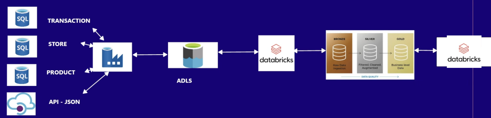
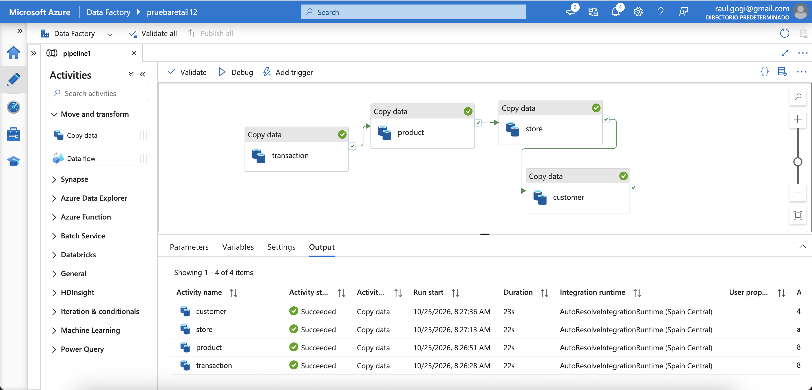
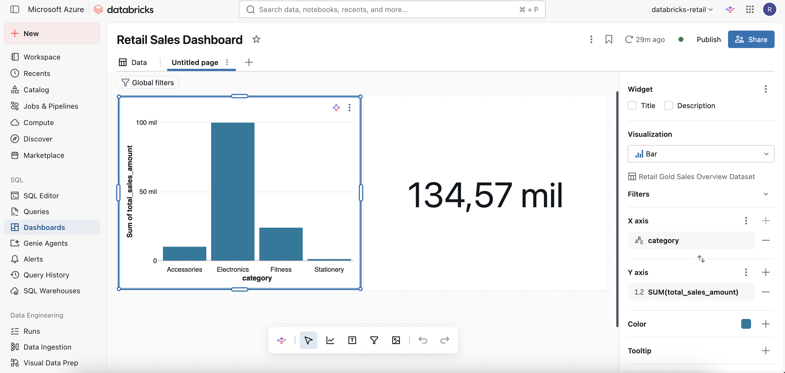

# Pipeline de datos retail en Azure (ADF + Databricks + Delta Lake)

Pipeline de datos por lotes en Azure. Con Azure Data Factory cargo datos de una base de datos Azure SQL y de un fichero JSON en un Data Lake (ADLS Gen2). Después los proceso con PySpark en Databricks siguiendo una arquitectura medallion (Bronze, Silver y Gold, en formato Delta) y los muestro en un dashboard de Databricks SQL.

> **De dónde sale:** empecé siguiendo el tutorial
> [End-to-End Azure Data Engineering PROJECT (ADF + Databricks + Power BI)](https://www.youtube.com/watch?v=rmjVNPJhMXs).
> Los datos de ejemplo (`data/customers.json`), el script SQL (`sql/create_tables.sql`) y el diagrama de arquitectura son del tutorial
> (repositorio de [manish040596](https://github.com/manish040596/azure-data-engineer---multi-source)).
> Lo que cambié yo está en el apartado [Qué hice distinto](#qué-hice-distinto).

## Arquitectura



El diagrama es el del tutorial. He modificado el último bloque: en el original el resultado se mostraba en Power BI y yo lo muestro en Databricks.

## Tecnologías

Azure Data Factory, Azure Data Lake Storage Gen2, Azure SQL Database, Azure Databricks (PySpark, Delta Lake, Unity Catalog) y Databricks SQL (warehouse serverless).

## Cómo funciona

1. **Ingesta (ADF).** Una pipeline con cuatro actividades Copy: `transactions`, `products` y `stores` desde Azure SQL, y `customers` desde un JSON descargado por HTTP. Todo se guarda como Parquet en la carpeta `bronze/` del contenedor `retail`.
2. **Silver (Databricks).** Leo Bronze, convierto los tipos de las columnas, elimino clientes duplicados por `customer_id`, uno las cuatro tablas con joins y calculo `total_amount = quantity × price`. El resultado se guarda en Delta y se registra como tabla `retail_silver_cleaned`.
3. **Gold (Databricks).** Agrupo Silver por fecha, producto y tienda y calculo cantidad vendida, importe total, número de transacciones y valor medio. Se guarda en Delta como tabla `retail_gold_sales_summary`.
4. **Dashboard.** Un dashboard de Databricks SQL sobre la tabla Gold, con un gráfico de ventas por categoría y el total de ventas (unos 134,6 mil en las unidades del dataset, que no indica moneda).

El dataset es pequeño y sintético: 10 productos, 5 tiendas y 50 clientes.

## Capturas

| Pipeline de ADF | Dashboard |
|---|---|
|  |  |

## Estructura del repositorio

```
.
├── adf/pipeline1.json                   # pipeline de ADF exportada (plantilla ARM)
├── data/customers.json                  # datos de ejemplo (del tutorial)
├── images/                              # diagrama y capturas
├── notebooks/01_medallion_pipeline.ipynb
├── sql/create_tables.sql                # tablas de origen en Azure SQL (del tutorial)
└── README.md
```

## Qué hice distinto

**Acceso al almacenamiento.** El tutorial monta el Data Lake en Databricks con `dbutils.fs.mount` y deja la clave de acceso de la cuenta de almacenamiento escrita en el código. En mi workspace ese método estaba bloqueado (Databricks lo da por obsoleto) y, además, tener una clave a la vista en el código no es buena práctica. Lo cambié así:

- Configuré **Unity Catalog** con una **External Location** apuntando al contenedor.
- La conexión con Azure usa una **identidad administrada** a través de un Access Connector, así que no hay contraseñas ni claves en el código.
- El notebook lee ahora con rutas `abfss://` directamente.

**Capa de consumo.** El tutorial termina en Power BI. Yo lo resolví dentro de Databricks, con un dashboard de Databricks SQL sobre un warehouse serverless. Por eso modifiqué también el final del diagrama.

## Limitaciones

- Ejecuté la pipeline a mano (debug). No tiene programación ni trigger.
- Las cuatro copias de ADF van una detrás de otra, aunque son independientes.
- La calidad de datos es básica: conversión de tipos y eliminación de clientes duplicados. No hay tratamiento de nulos ni comprobaciones, y los `inner join` descartarían sin avisar transacciones sin cliente, producto o tienda.
- El notebook no se puede relanzar tal cual: `CREATE TABLE` falla si la tabla ya existe.
- Los ficheros de clientes quedaron en una ruta larga heredada de la fuente HTTP, y el notebook la tiene escrita a mano.
- El dashboard es un borrador, con solo dos gráficos.

## Siguientes pasos

- Lanzar los notebooks desde ADF o desde un Job de Databricks, con programación.
- Añadir comprobaciones de filas y nulos entre capas.
- Usar `CREATE TABLE IF NOT EXISTS` y parametrizar la ruta del almacenamiento.
- Ampliar el dashboard con ventas por fecha, productos más vendidos y ventas por tienda.

## Créditos

Tutorial, datos de ejemplo y diagrama original: canal *learn by doing it* y [manish040596](https://github.com/manish040596).